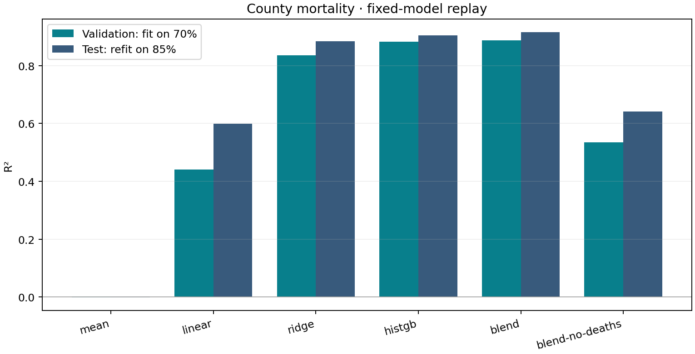

<div align="center">
  <h3 align="center">Cancer Mortality Regression</h3>

  <p align="center">
    A county-level regression pipeline combining <strong>feature engineering</strong>, <strong>Ridge regression</strong>, and <strong>gradient boosting</strong> to estimate cancer mortality rates.
    <br />
    <a href="#-getting-started"><strong>Quick Start »</strong></a>
  </p>

  <p align="center">
    
    
    
    
  </p>
</div>

## 🔍 About The Project

This project estimates **county-level cancer mortality rates** from demographic, economic, and health-related variables. It began as a University of Cincinnati regression assignment comparing linear models with fully connected neural networks, then expanded into a Kaggle experiment with engineered features and model ensembles.

The portfolio edition provides a reproducible training and inference workflow, compares fixed baselines, and measures how much the ensemble depends on death-related predictors. It preserves the original coursework and subsequent CatBoost/LightGBM research in a separate archive.

*Built as an academic machine-learning project focusing on tabular modeling, experimental evaluation, and reproducible pipelines.*

## 🛠 Built With

- **Language:** Python 3.10+
- **Machine Learning:** scikit-learn — Ridge, HistGradientBoosting, VotingRegressor
- **Data Processing:** pandas, NumPy
- **Visualization:** Matplotlib
- **Model Persistence:** Joblib
- **Archived Experiments:** MLPRegressor, CatBoost, LightGBM

## 📐 Architecture

```text
County records → Row-local feature engineering → Training-only preprocessing
                                                     │
                              ┌──────────────────────┴───────────────────┐
                              ▼                                          ▼
                       Ridge regression                    Histogram gradient boosting
                              └──────────────────────┬───────────────────┘
                                                     ▼
                                      35% Ridge + 65% HistGB
                                                     ▼
                                       Mortality-rate predictions
```

### Technical Highlights

- **Feature Engineering:** state extraction, log-count transforms, incidence/population ratios, and an explicit correction for apparent month-valued median ages.
- **Training-Only Preprocessing:** median imputation, missingness indicators, standardization, and categorical encoding are fitted inside each training fold.
- **Linear/Nonlinear Ensemble:** combines regularized linear estimates with boosted trees using fixed weights inherited from the competition work.
- **Death-Feature Ablation:** removes annual death counts and every feature derived from them while preserving the same model settings and partitions.
- **Separated Evaluation and Refit:** validation selects a candidate; a separate command fits a fixed model on all labels for competition inference.
- **Traceable Runs:** exports fold scores, partition indices, dataset fingerprints, software versions, and model checkpoints.

### File Organization

```text
├── model.py                 # Feature builder, preprocessing and fixed candidates
├── train.py                 # Comparison, validation selection and evaluation export
├── refit.py                 # All-label fit for competition inference
├── predict.py               # Ordered, finite CSV predictions
├── demo.py                  # Offline synthetic execution demonstration
├── data/README.md           # Dataset schema, provenance and availability
├── results/                 # Recorded real-data replay and metadata
├── figures/comparison.png   # Recorded model comparison
├── tests/test_pipeline.py   # Data isolation, ablation and inference checks
├── archive/                 # Original coursework and later Kaggle experiments
├── VALIDATION.md            # Verified commands, environment and limitations
└── requirements*.txt        # Core and optional research dependencies
```

## 🚀 Getting Started

### Prerequisites

- Python 3.10+ and PIP
- No GPU required
- The course competition CSVs for reproducing the real-data results

### Installation

Clone the repository and install the dependencies:

```bash
git clone https://github.com/EnzoPicarel/cancer-mortality-regression.git
cd cancer-mortality-regression
python -m venv .venv
source .venv/bin/activate
python -m pip install -r requirements.txt
```

Start with the offline demo:

```bash
python demo.py
```

This generates synthetic county records, trains the candidates, reloads the selected checkpoint, and exports predictions. **Its scores are execution checks, not cancer-model benchmark results.** Use a fresh destination for another run: `python demo.py --output artifacts/demo-2`.

### Dataset

The real-data replay used **2,437 labeled county records** and a separate competition file with **610 unlabeled records**. The label is `TARGET_deathRate`; `id` preserves row order in the submission. County names and row IDs are excluded from predictors.

Place `train.csv` and `test.csv` in `data/`, or supply their paths explicitly. The competition files are not redistributed in this package. See [`data/README.md`](data/README.md) for schema, provenance, the age-correction assumption, and predictor-availability limitations.

## ⚡ Execution

Compare the fixed candidates on the labeled data:

```bash
python train.py --data data/train.csv --output artifacts/evaluation
```

The command uses a seeded **70% train / 15% validation / 15% test** partition. Repeated 5-fold CV runs twice inside the training partition only. Candidates are selected using validation R² before test scoring; each fixed candidate is then refitted on train + validation for the final comparison.

Generated files include `evaluation.csv`, `cv_folds.csv`, `metadata.json`, `comparison.png`, and the selected `model.joblib`. Choose a new output directory for each run.

Fit the historical 35/65 ensemble on every labeled row, then export competition predictions:

```bash
python refit.py --data data/train.csv --model blend --output artifacts/submission_model.joblib

python predict.py \
  --data data/test.csv \
  --checkpoint artifacts/submission_model.joblib \
  --output artifacts/submission.csv
```

The resulting CSV preserves input IDs and contains `id,TARGET_deathRate`. All-label refitting produces no held-out score. The serialized estimators are local Python/Joblib artifacts; load checkpoints from a trusted source.

## 📊 Results

Recorded on the supplied county data with seed 42. Validation models use 1,705 rows; final test models are refitted on 2,071 development rows and evaluated on the same 366 test rows.

| Model | Validation R² | Replay test R² | Replay test RMSE |
|---|---:|---:|---:|
| Mean predictor | -0.0011 | -0.0011 | 27.51 |
| Linear baseline | 0.4411 | 0.5986 | 17.42 |
| Ridge with engineered features | 0.8360 | 0.8840 | 9.36 |
| HistGradientBoosting | 0.8835 | 0.9044 | 8.50 |
| **35% Ridge + 65% HistGB** | **0.8872** | **0.9149** | **8.02** |
| Same blend, death-related features removed | 0.5348 | 0.6412 | 16.47 |



The ensemble was selected on validation. Removing death-related features substantially lowers its replay score: those predictors carry much of the useful information. This supports a county-statistics estimation task, but does not establish prediction of future mortality from information available beforehand.

Historical project documents record owner-reported **Kaggle R² = 0.89414** for the Ridge/HistGB blend and **0.91231** for a later CatBoost blend. Those leaderboard scores were not independently verified during this portfolio preparation and are separate from the replay above. See [`archive/README.md`](archive/README.md) for the original protocols and research history.

## 🧪 Tests

```bash
python -m unittest discover -s tests -v
```

Tests cover exclusion of targets and identifiers, removal of death-derived features, training-only imputation, unseen categories, disjoint partitions, non-mutating age correction, checkpoint loading, and prediction schema/order.

See [`VALIDATION.md`](VALIDATION.md) for the recorded verification, including the full-data comparison and 610-row prediction export.

## ⚠️ Evaluation Notes

- **Historical data reuse:** feature sets and model settings were developed on these data before the portfolio replay. Its splits isolate fitting and selection within this run; they do not create a historically unseen test set.
- **Predictor availability:** death counts and related rates may be measured during the target period. The ablation quantifies their contribution; it does not establish prospective availability of the remaining features.
- **Geographic scope:** random county splits may share states across partitions. Generalization to new states or future years has not been demonstrated.
- **Aggregate outcome:** these are county-level estimates, not individual clinical diagnoses or causal effects.

## 👥 Authors

- **Enzo Picarel**

*Developed at the University of Cincinnati. The original assignment permitted AI assistance; the project documents critical review of preprocessing and evaluation choices.*
