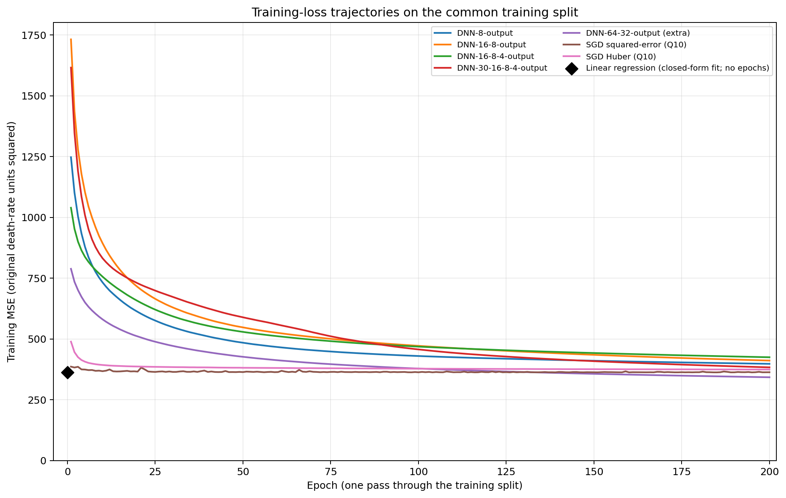

# Homework 1: Linear Regression and Neural Network Regression

**Steps 1–5**

This report covers Steps 1–5. It uses the labeled rows in `train.csv` for model development; Kaggle's unlabeled `test.csv` is reserved for the final prediction file and is not used to calculate the local metrics below. The prompt log and Step 6 reflection are in the accompanying AI-use report.

## Step 1: Data

### 1. How many data samples are included in the dataset?

`train.csv` contains **2,437 labeled county samples**. The separate Kaggle `test.csv` contains another **610 unlabeled samples**, for 3,047 rows across the two files. Model evaluation uses only the 2,437 labeled samples.

### 2. Which problem does this dataset address?

This is a **supervised regression** problem. The task is to estimate each county's cancer mortality rate from demographic, economic, education, and health-coverage variables.

### 3. What are the minimum and maximum values in the dataset?

The target, `TARGET_deathRate`, ranges from **59.7 to 362.8** in `train.csv`. Across the numeric columns, the minimum is **0** and the maximum is **10,170,292** in `popEst2015`. The raw `MedianAge` maximum is **624**, an anomalous value investigated in preprocessing: values above 100 appear to be months rather than years.

### 4. How many features are in each data sample?

The training file has 35 columns: 34 columns besides the target, including `id`. Excluding the target and the non-predictive row ID leaves **33 predictor features**, including `Geography`. Because every county name occurs only once, `Geography` is excluded from the baseline model, leaving **32 model input features**.

### 5. Does the dataset contain missing information?

Yes. Three training features contain missing values:

| Feature | Missing rows |
|---|---:|
| `PctSomeCol18_24` | 1,828 / 2,437 |
| `PctEmployed16_Over` | 123 / 2,437 |
| `PctPrivateCoverageAlone` | 480 / 2,437 |

Numeric missing values are imputed using the median learned from the training split. Missingness indicators are also added.

### 6. What is the label of this dataset?

The label is **`TARGET_deathRate`**.

### 7. What percentage of data is used for training, validation, and testing?

The 2,437 labeled samples are split once with random seed 42 into **70% training (1,705 rows), 15% validation (366 rows), and 15% local testing (366 rows)**. The local test split is held out from model selection. Kaggle's 610 unlabeled rows are used only to produce competition predictions.

### 8. What preprocessing is applied to the training data?

I exclude `id` because it is only a row identifier. Each `Geography` value is unique, so county-level one-hot encoding could let a model memorize row identities and would not give a reusable county effect for unseen counties. I retain the low-cardinality `binnedInc` category and one-hot encode it. Numeric features are median-imputed, numeric missingness indicators are added, and numeric columns are standardized using statistics fitted on the training split only. I also found **30** `MedianAge` values above 100 across train and test; dividing these by 12 places each between its corresponding male and female median ages. I apply this apparent months-to-years correction consistently before fitting the preprocessing pipeline.

## Step 2: Models and results

The reported “test” values below are from the **366-row local test split**, not from Kaggle's hidden test labels. The table includes the required linear and neural-network models, the extra DNN, and the Huber SGD comparison. MSE is in squared death-rate units.

| Model | Train R² | Validation R² | Local test R² | Local test MSE |
|---|---:|---:|---:|---:|
| Linear regression | 0.5533 | **0.4411** | 0.5964 | 305.06 |
| DNN-8-output | 0.5448 | 0.3760 | 0.5272 | 357.32 |
| DNN-16-8-output | 0.5477 | 0.4092 | 0.5590 | 333.30 |
| DNN-16-8-4-output | 0.5155 | 0.3451 | 0.5325 | 353.30 |
| DNN-30-16-8-4-output | 0.5477 | 0.4173 | 0.5673 | 327.06 |
| DNN-64-32-output (extra) | **0.6401** | 0.4125 | **0.6068** | **297.16** |
| SGD regression (Huber loss) | 0.5207 | 0.4277 | **0.6011** | **301.46** |

Linear regression has the best validation R². DNN-64-32 has the best local-test R² and MSE, but the local test is held out for reporting and is not used to select a model.

## 9. Analyze bias and variance. Which models underfit or overfit? Which works best and worst, and why?

Linear regression has a moderate train-to-validation gap (R² 0.5533 versus 0.4411) and the strongest validation result. It is the best model by the model-selection split, suggesting that the available data supports a relatively simple relationship more reliably than the tested neural networks.

The DNN-64-32 model has the strongest training fit (R² 0.6401) but a lower validation R² (0.4125), a gap of 0.2276. This is the clearest overfitting signal: added capacity improves training fit without improving validation performance. It does have the highest local-test R² (0.6068), which illustrates why the held-out local test should not be used to choose the model. DNN-16-8-4 has the weakest neural-network training fit (R² 0.5155) and the lowest validation R² (0.3451), making it the worst model on both of those measures and a possible underfitting/high-bias case. However, all five DNNs reached the 200-iteration limit with convergence warnings, so poor optimization may also explain their results; one split cannot separate these causes. The gap between the validation and local-test results also shows sensitivity to which counties fall into each split.

## Step 3: Objective and Question 10

### 10. Can you try a different loss function?

Yes. I ran a controlled comparison using the same `SGDRegressor`, preprocessing, seed-42 split, target scaling, and SGD settings. The only model setting changed was the loss: squared-error (MSE) versus Huber (`epsilon=0.1`). Both used `max_iter=3000` and `tol=1e-4` and the same default SGD learning-rate and regularization settings.

| Loss | Epochs | Validation MSE | Validation R² | Local test MSE | Local test R² |
|---|---:|---:|---:|---:|---:|
| Squared-error (MSE) | 25 | **395.44** | **0.4496** | 303.57 | 0.5983 |
| Huber (`epsilon=0.1`) | 15 | 411.15 | 0.4277 | **301.46** | **0.6011** |

Squared-error performs better on validation: MSE is lower by 15.71 and R² is higher by 0.0219. Huber is designed to reduce the influence of large residuals; here it is slightly worse on validation but slightly better on the local test split. The local-test difference is small, and I use validation—not the held-out local test—to judge this comparison. The two splits rank the losses differently, showing the uncertainty from a single partition. Reproducible details are in `loss_comparison.py` and `loss_comparison.csv`.

## Step 4: Optimization

The DNNs use stochastic gradient descent (`solver="sgd"`) with the `MLPRegressor` default settings for the other training parameters; `random_state=42` is set for reproducibility. In this environment, those defaults include a constant learning rate, initial rate 0.001, automatic batch size, a 200-iteration limit, and no early stopping. The target is standardized using the training split and predictions are converted back to death-rate units for evaluation. All five DNNs reached the iteration limit and raised a convergence warning. The controlled SGD loss comparison uses identical `SGDRegressor` optimizer settings for both losses.

## Step 5: Model performance and Question 11

The table in Step 2 reports training, validation and local-test R² and the local-test MSE for every compared model. The full results are in `model_results.csv`. The figure below overlays per-epoch training MSE for the five DNN architectures and the two SGD loss variants on the same 1,705-row training partition. The DNN curves show a 200-epoch diagnostic run to record full histories; the table scores come from the separate default `MLPRegressor` fits. Ordinary least squares has a closed-form solution rather than an epoch-wise optimization path, so its terminal training MSE is shown as a point at epoch zero.

### 11. Include all models' loss plots in one figure.

The DNN curves continue to reduce training error through the 200-epoch limit, while both `SGDRegressor` curves level off earlier. The Huber model's plotted values are its training MSE for comparison; Huber itself optimizes the alternative Huber loss. The black point is the closed-form linear-regression fit, not an invented training trajectory.

For the separate Kaggle task, subsequent feature engineering and model blending produced `submission.csv`, which received a public Kaggle R² of **0.89414**. That competition-specific result is documented in `model_improvement_log.md`; it is separate from the required architecture comparison above. The final Ridge + HistGradientBoosting blend was trained by `final_tuning.py` and saved as `final_tuned_model.joblib`.

## Step 6: AI usage and reflection

Question 12 and the prompt log are documented separately as required. The reflection in `ai_usage_report.md` describes how one-hot encoding `Geography` was a poor initial suggestion, how the unique-county counts and near-zero training error exposed the problem, and why county identity was removed from the baseline model.
